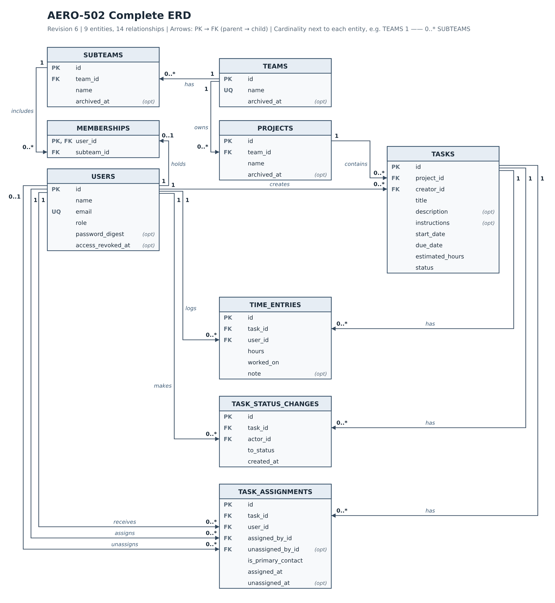

# Database design check

Checked by Joshua Eng on November 17, 2026 and checked again on November 23, 2026, after release v30 added three migrations, against [`db/structure.sql`](https://github.com/joshEng1/AERO-502/blob/9faa5b95983ce2bf371e95ad6073fc80e11e0316/db/structure.sql) at the deployed commit `9faa5b9`. The production database has the same tables, columns and foreign keys as that file; see [the final release verification](FINAL_RELEASE_VERIFICATION.md).

## Approved ERD

**Revision 6: 9 entities, 14 foreign-key relationships.** It incorporates the professor and TA data-design review of **October 27, 2026** and the customer's October 22, 2026 reply that a project belongs to one team. Source: Sprint 3 Project Notebook v3.3, Appendix B1.

## Entity count

| Kind | Count | Tables |
| --- | ---: | --- |
| Domain (base) entities | 7 | TEAMS, SUBTEAMS, PROJECTS, USERS, TASKS, TIME_ENTRIES, TASK_STATUS_CHANGES |
| Join (relationship) tables | 3 | MEMBERSHIPS (user to subteam), TASK_ASSIGNMENTS (user to task, with the assignment period), TASK_DEPENDENCIES (task to prerequisite task) |
| **Qualifying tables** | **10** | |
| Sign-in provider (OAuth) tables | 0 | Google sign-in stores nothing of its own; the app matches the verified email against USERS |
| Framework support tables, not counted | 2 | `schema_migrations`, `ar_internal_metadata` (Rails) |

Team size: 2 members (Joshua Eng, Sonny Hernandez). Ten qualifying tables meet the requirement of one per team member.

## Implementation compared with the approved ERD

Every table, attribute, key and relationship in Revision 6 is present. Line numbers are in `db/structure.sql`.

| ERD entity | Implemented as | Keys and relationships |
| --- | --- | --- |
| TEAMS (id, name UQ, archived_at) | [line 363](https://github.com/joshEng1/AERO-502/blob/9faa5b95983ce2bf371e95ad6073fc80e11e0316/db/structure.sql#L363) | PK id; unique name (line 733) |
| SUBTEAMS (id, team_id, name, archived_at) | [line 208](https://github.com/joshEng1/AERO-502/blob/9faa5b95983ce2bf371e95ad6073fc80e11e0316/db/structure.sql#L208) | PK id; FK team_id → teams; unique (team_id, name) (line 656) |
| PROJECTS (id, team_id, name, archived_at) | [line 166](https://github.com/joshEng1/AERO-502/blob/9faa5b95983ce2bf371e95ad6073fc80e11e0316/db/structure.sql#L166) | PK id; FK team_id → teams; unique (team_id, name ignoring letter case) (line 635) |
| USERS (id, name, email UQ, role, password_digest, access_revoked_at) | [line 430](https://github.com/joshEng1/AERO-502/blob/9faa5b95983ce2bf371e95ad6073fc80e11e0316/db/structure.sql#L430) | PK id; unique email (line 754); role limited to three values (line 441) |
| MEMBERSHIPS (user_id PK and FK, subteam_id FK) | [line 137](https://github.com/joshEng1/AERO-502/blob/9faa5b95983ce2bf371e95ad6073fc80e11e0316/db/structure.sql#L137) | PK user_id, so one membership per user; FK user_id → users; FK subteam_id → subteams |
| TASKS (id, project_id, creator_id, title, description, instructions, start_date, due_date, estimated_hours, status) | [line 324](https://github.com/joshEng1/AERO-502/blob/9faa5b95983ce2bf371e95ad6073fc80e11e0316/db/structure.sql#L324) | PK id; FK project_id → projects; FK creator_id → users |
| TASK_ASSIGNMENTS (id, task_id, user_id, assigned_by_id, unassigned_by_id, is_primary_contact, assigned_at, unassigned_at) | [line 241](https://github.com/joshEng1/AERO-502/blob/9faa5b95983ce2bf371e95ad6073fc80e11e0316/db/structure.sql#L241) | PK id; four FKs (task, assignee, assigned by, unassigned by); one active assignment per task and user (line 775); one primary contact per task (line 782); ending fields set together (line 252) |
| TIME_ENTRIES (id, task_id, user_id, hours, worked_on, note) | [line 395](https://github.com/joshEng1/AERO-502/blob/9faa5b95983ce2bf371e95ad6073fc80e11e0316/db/structure.sql#L395) | PK id; FK task_id → tasks; FK user_id → users |
| TASK_STATUS_CHANGES (id, task_id, actor_id, to_status, created_at) | [line 291](https://github.com/joshEng1/AERO-502/blob/9faa5b95983ce2bf371e95ad6073fc80e11e0316/db/structure.sql#L291) | PK id; FK task_id → tasks; FK actor_id → users |

Foreign keys: 14 for the nine approved entities, plus 2 for TASK_DEPENDENCIES, 16 in total ([lines 930 to 1050](https://github.com/joshEng1/AERO-502/blob/9faa5b95983ce2bf371e95ad6073fc80e11e0316/db/structure.sql#L930)). Rails also keeps `created_at` and `updated_at` on most tables; Revision 6 states that existing timestamps remain.

## Differences from the approved ERD

| Difference | Decision and approval status | Evidence |
| --- | --- | --- |
| **TASK_DEPENDENCIES** (task_id, prerequisite_task_id; composite primary key; two FKs to TASKS; no self-link; cycles rejected) is implemented and is not in the nine-entity Revision 6 diagram. | Required by story KAN-38 (scope S06, prerequisites and blockers), which is approved scope. Sprint 3 Notebook Appendix B9 put the table to the professor and TA as a separate question. The repository's design record describes the table as approved; a dated teaching-team decision is **not on file**, so the status is **Not Communicated** until that record is attached. | [Table, line 301](https://github.com/joshEng1/AERO-502/blob/9faa5b95983ce2bf371e95ad6073fc80e11e0316/db/structure.sql#L280); [design record](https://github.com/joshEng1/AERO-502/blob/9faa5b95983ce2bf371e95ad6073fc80e11e0316/docs/SPRINT3_STORIES_VERIFICATION.md); [tests](https://github.com/joshEng1/AERO-502/blob/9faa5b95983ce2bf371e95ad6073fc80e11e0316/spec/requests/board_creation_and_dependencies_spec.rb) |
| **USERS has two added columns**, `removed_at` and `permanently_removed_at` (both timestamps, with a check that a permanently removed person cannot sign in). They are not in the Revision 6 diagram. | Added on November 19, 2026 for the customer's request to manage former members (C02). No table, key or relationship changed. The teaching team has not been asked about this change, so the status is **Not Communicated**. | [USERS, line 430](https://github.com/joshEng1/AERO-502/blob/9faa5b95983ce2bf371e95ad6073fc80e11e0316/db/structure.sql#L430); migrations [add removal](https://github.com/joshEng1/AERO-502/blob/9faa5b95983ce2bf371e95ad6073fc80e11e0316/db/migrate/20261119120000_add_removal_to_users.rb) and [add permanent removal](https://github.com/joshEng1/AERO-502/blob/9faa5b95983ce2bf371e95ad6073fc80e11e0316/db/migrate/20261119180000_add_permanent_removal_to_users.rb) |
| **A Chief Engineer can hold a task assignment.** Revision 6 allowed assignments only for people with a subteam membership. | Changed on November 19, 2026 for the customer's request to assign himself to tasks (C01). The rule lives in the database integrity function; no table or column changed. Status: **Not Communicated**. | Migration [allow Chief Engineer assignments](https://github.com/joshEng1/AERO-502/blob/9faa5b95983ce2bf371e95ad6073fc80e11e0316/db/migrate/20261119121000_allow_chief_engineer_assignments.rb); tests [chief self-assignment](https://github.com/joshEng1/AERO-502/blob/9faa5b95983ce2bf371e95ad6073fc80e11e0316/spec/requests/chief_self_assignment_spec.rb) |
| Role names are stored as member, officer and Chief Engineer. Revision 6 proposed member, subteam_lead and admin and said to map the existing names. | Naming only; the three roles and their rules are the approved ones. | [USERS, line 430](https://github.com/joshEng1/AERO-502/blob/9faa5b95983ce2bf371e95ad6073fc80e11e0316/db/structure.sql#L430) |

No other difference was found. The two added USERS columns each hold one date for one person and depend only on the user, so they do not change the third-normal-form findings below.

## Third normal form

| Check | Finding |
| --- | --- |
| Several values stored in one field | **None.** No array, JSON or delimited-list column exists in `db/structure.sql`. A task's assignees are rows in TASK_ASSIGNMENTS, its prerequisites are rows in TASK_DEPENDENCIES, and its status history is rows in TASK_STATUS_CHANGES. |
| Repeating columns | **None.** No table has numbered or repeated columns such as `assignee_1`, `assignee_2`. |
| The same fact stored in two tables | **One documented, approved copy.** TASKS.status equals the latest TASK_STATUS_CHANGES.to_status so the board can filter by status without reading the history. Revision 6 (B2 and B6) approved this; both values are written in one transaction and a database trigger rejects a mismatch. |
| Derived organization values | **None stored.** A task's team comes from its project (TASKS.project_id → PROJECTS.team_id). A member's team comes from the membership (MEMBERSHIPS.subteam_id → SUBTEAMS.team_id). TASKS and USERS hold no team or subteam column, which was the TA's October 12 concern. |
| Partial or transitive dependencies | **None found.** Each table's non-key columns depend only on that table's key; the table-by-table review is in Sprint 3 Notebook Appendix B6 and matches the columns above. |
| Approved exception | Reference links are written inside the free-text TASKS.instructions instead of a separate TASK_LINKS table. The October 27 review directed this change, because every role opens one shared task page whose address comes from TASKS.id. |

Tests that write directly to the database to exercise these rules, all passing in [CI run 45305381239](https://github.com/joshEng1/AERO-502/actions/runs/45305381239/job/138147842394): [history and integrity](https://github.com/joshEng1/AERO-502/blob/9faa5b95983ce2bf371e95ad6073fc80e11e0316/spec/models/database_history_integrity_spec.rb), [membership and ownership](https://github.com/joshEng1/AERO-502/blob/9faa5b95983ce2bf371e95ad6073fc80e11e0316/spec/models/organization_membership_spec.rb), [migration from the earlier schema](https://github.com/joshEng1/AERO-502/blob/9faa5b95983ce2bf371e95ad6073fc80e11e0316/spec/models/legacy_migration_spec.rb).
